# Forum Platform — API Workflow Guide

**Document type:** end-to-end feature workflows across the API Gateway and six microservices

**Companion document:** `docs/api/forum_api_endpoint_reference.md`

**Baseline:** repository worktree at commit `bf3384c` plus uncommitted changes present on 2026-10-23

**Runtime status:** not runtime-verified. No container, database, migration, or endpoint was started or invoked. Workflows are reconstructed from source code, canonical OpenAPI/contract documents, and repository tests.

---

## 1. How to read the diagrams

Every Mermaid sequence diagram uses the same visual vocabulary and labels the interaction class explicitly:

- **Synchronous HTTP** — a caller waits for the response. Rendered as a normal request/response arrow.
- **Database transaction** — a service-local commit boundary. Rendered as a self-message such as `Content->>Content: DB transaction: insert thread + outbox`.
- **Outbox write** — a domain event inserted in the same local transaction as the business change.
- **Asynchronous delivery** — a background outbox worker posts the event to a consumer's `/internal/events` endpoint after the producer transaction commits.
- **Background worker** — a polling loop independent of any request (outbox worker, email worker, attachment cleanup).

The diagrams intentionally show *source behavior*, including known gaps. A dashed arrow labeled "gap" or a note marks behavior that differs from the canonical contract.

### 1.1 Synchronous vs asynchronous boundary summary

| Interaction | Class | Timeout / retry |
|---|---|---|
| Client → Gateway → service | Sync HTTP | Gateway 5 MB body cap; upstream timeouts map to `504`; connect failures to `503`; no automatic request retry. |
| Downstream service → User `/auth/session` | Sync HTTP | 5 s client timeout; unreachable → `503`. |
| Interaction/Moderation → Content or User for target verification/enforcement | Sync HTTP | 5 s client timeout; failure surfaces as `400 INVALID_TARGET`, `503`, or `400 ACTION_FAILED`. |
| User → Content avatar claim/release | Sync HTTP | 5 s timeout; claim failure aborts; release failure logged only. |
| Search reindex → Content | Sync HTTP | `503`/`502` on failure; no retry. |
| Producer → outbox worker → consumer `/internal/events` | Async | At-least-once; exponential backoff with jitter; up to 5 attempts; 4xx (except 408/429) dead-letters immediately. |
| Notification → EmailDelivery worker → SMTP/memory | Async background | At-least-once; lease recovery; exponential backoff; max 5 attempts; recipient rejection dead-letters. |

---

## 2. Workflow index

| ID | Workflow | Primary entry points | Services involved | Async events | Status |
|---|---|---|---|---|---|
| WF-01 | Registration, OTP verification, welcome | `POST /auth/register`, `/auth/register/verify`, `/auth/register/resend-otp` | Gateway, User, Notification, email worker | `UserRegistered` | `IMPLEMENTED` |
| WF-02 | Login, session use, logout | `POST /auth/login`, `GET /auth/session`, `POST /auth/logout` | Gateway, User, all validating services | none | `IMPLEMENTED` |
| WF-03 | Password recovery and reset | `/auth/recovery/*` | Gateway, User | none | `IMPLEMENTED` |
| WF-04 | Profile edit and avatar lifecycle | `PATCH /profile`, `POST /uploads/images`, `PUT/DELETE /profile/avatar` | Gateway, User, Content | none | `IMPLEMENTED` with non-atomic cross-service steps |
| WF-05 | Email change | `/profile/change-email/*` | Gateway, User | none | `IMPLEMENTED` |
| WF-06 | Password change | `POST /profile/change-password` | Gateway, User | none | `IMPLEMENTED` |
| WF-07 | Thread creation with images and indexing | `POST /uploads/images`, `POST /threads` | Gateway, User, Content, Search, Notification | `ThreadCreated` | `PARTIALLY_IMPLEMENTED` |
| WF-08 | Browse, thread detail, view tracking | `GET /threads`, `GET /threads/{id}`, `POST /threads/{id}/view` | Gateway, Content, Interaction, Search | `ThreadViewCountIncremented` | `IMPLEMENTED` |
| WF-09 | Thread edit, delete, lock, pin, best answer | `PATCH/DELETE /threads/{id}`, lock/pin/best-answer | Gateway, Content, Search, Notification | `ThreadUpdated`, `ThreadDeleted`, `ThreadLockToggled`, `ThreadPinToggled`, `BestAnswerChanged` | `PARTIALLY_IMPLEMENTED` |
| WF-10 | Comment lifecycle | `GET/POST /threads/{id}/comments`, `PATCH/DELETE /comments/{id}` | Gateway, Content, Notification | `CommentCreated`, `CommentUpdated`, `CommentDeleted` | `PARTIALLY_IMPLEMENTED` |
| WF-11 | Voting, reputation, vote notifications | `PUT /threads/{id}/vote`, `PUT /comments/{id}/vote` | Gateway, Interaction, Content, Notification | `VoteChanged` | `PARTIALLY_IMPLEMENTED` |
| WF-12 | Bookmarks and reputation read | bookmark endpoints, `GET /profile/bookmarks`, `GET /users/{id}/reputation` | Gateway, Interaction, Content | none | `IMPLEMENTED` |
| WF-13 | Abuse report submission | `POST /reports`, `GET /reports/mine` | Gateway, Moderation, Content, User | none | `PARTIALLY_IMPLEMENTED` |
| WF-14 | Moderation queue and enforcement | `/moderation/reports*`, `/moderation/actions` | Gateway, Moderation, Content, User, Search, Notification | `ModerationActionApplied` | `PARTIALLY_IMPLEMENTED` |
| WF-15 | Notification inbox, preferences, email delivery | `/notifications*` | Gateway, Notification, User, email worker | consumed events + email deliveries | `PARTIALLY_IMPLEMENTED` |
| WF-16 | Search query, suggestions, reindex | `GET /search`, `/search/suggestions`, `POST /admin/reindex` | Gateway, Search, Content | index events | `IMPLEMENTED` |
| WF-17 | Admin user management | `GET /admin/users`, role/ban | Gateway, User, Moderation | none | `PARTIALLY_IMPLEMENTED` |
| WF-18 | Generic outbox delivery, retry, dead-letter | all producer outbox tables | Producers, outbox worker, consumers | all routed events | `IMPLEMENTED` |
| WF-19 | Email dispatch, lease recovery, dead-letter | `email_deliveries` | Notification email worker | email deliveries | `IMPLEMENTED` |
| WF-20 | Gateway request pipeline and error handling | `/api/v1/{path}` | Gateway, any service | none | `IMPLEMENTED` |

---

## 3. WF-01 — Registration, OTP verification, welcome

**Trigger:** an unauthenticated visitor submits registration details.

**Preconditions:** none; rate limiter allows the client IP.

**Primary contract:** `POST /auth/register` → `202`; `POST /auth/register/verify` → `201`; `POST /auth/register/resend-otp` → `202`.

### Sequence

1. Gateway routes `auth/*` to User Service, stripping client identity headers.
2. `POST /auth/register` applies an IP rate limit, normalizes username/email, and returns a neutral `202` if an active account already exists.
3. User Service locks/selects `pending_registrations`, hashes the password, generates a 6-digit OTP with a 10-minute TTL, and commits the pending row.
4. OTP delivery happens **after** commit. Delivery failure marks the pending row `delivery_failed`; the public response remains neutral `202`.
5. `POST /auth/register/verify` locks the pending row, checks attempt count (max 5) and expiry, verifies the OTP hash, rejects an existing account, inserts `accounts`, marks the pending row `consumed`, and inserts a `UserRegistered` outbox row in the same transaction.
6. The User outbox worker claims `UserRegistered` and posts it to Notification `/internal/events` with `X-Internal-Service-Key`.
7. Notification creates a `welcome` in-app item and a mandatory welcome email delivery, records per-recipient `consumed_events`, and commits.
8. The Notification email worker later claims the delivery and sends it via SMTP or the memory sink.

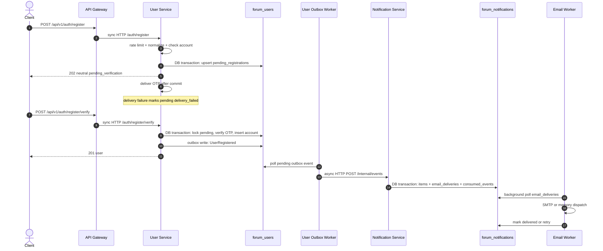

### Data effects

- `pending_registrations`: insert/update, OTP hash, attempts, resend counters, `status`.
- `accounts`: insert active account with `email_verified_at`, Argon2id hash, role `member`.
- `outbox_events`: `UserRegistered`.
- Notification `items`, `email_deliveries`, `consumed_events`.

### Failure and retry

- Delivery failure never leaks account existence; pending challenge becomes unverifiable.
- Wrong/expired/exceeded OTP returns `400` with `INVALID_OTP`, `OTP_EXPIRED`, or `OTP_ATTEMPTS_EXCEEDED`.
- Concurrent verification is serialized by `SELECT ... FOR UPDATE`; a duplicate account races into `409 ACCOUNT_ALREADY_EXISTS`.
- `UserRegistered` delivery is at-least-once; Notification deduplicates by `(event_id, recipient_id)`.

### Known gaps

- `POST /auth/register/verify` can return `409 ACCOUNT_ALREADY_EXISTS`, which OpenAPI does not list.
- Resend cooldown/quota returns neutral `202`, so callers cannot tell whether a new code was actually sent.
- The welcome email is mandatory even when the user has email notifications disabled.

---

## 4. WF-02 — Login, session use, logout

**Trigger:** credentials submitted; later requests reuse the session cookie.

**Primary contract:** `POST /auth/login` → `200` + `Set-Cookie`; `GET /auth/session` → `200`; `POST /auth/logout` → `204`.

### Sequence

1. Login applies an IP rate limit, normalizes the username/email, selects `accounts`, verifies the Argon2id hash, and rejects banned accounts.
2. User Service inserts a `sessions` row containing the token hash, idle expiry, absolute expiry, user agent, and IP; returns the opaque token in `forum_session` (`HttpOnly`, `SameSite=Lax`, `Secure` when configured).
3. On each protected request, the owning service either validates against User Service `GET /auth/session` or honors trusted forwarded identity headers (not reachable publicly because the Gateway strips them).
4. User Service checks revocation, absolute expiry, idle expiry, and ban status. It refreshes `last_seen_at`/`idle_expires_at` at most once per 60 seconds.
5. Logout requires CSRF when a cookie is present, sets `revoked_at`/`revocation_reason`, and deletes the cookie.

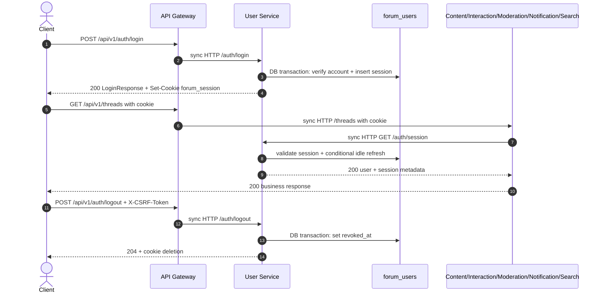

### Failure and retry

- Invalid credentials → `401 INVALID_CREDENTIALS`; banned → `403 ACCOUNT_BANNED`.
- Downstream User Service outage → protected endpoint returns `503`.
- Revoked/expired sessions → `401`; banned account on a still-valid session → `403`.
- Logout is not retried automatically; a second logout fails authentication because the session is already revoked.

### Known gaps

- Source code uses `ACCOUNT_BANNED`, while the contract catalog names `ACCOUNT_RESTRICTED`.
- CSRF verification is skipped when no cookie is present, so CSRF is not a standalone authentication mechanism.

---

## 5. WF-03 — Password recovery and reset

**Trigger:** user requests recovery, verifies the OTP, then submits a reset token and new password.

**Primary contract:** request `202`; verify `200 {reset_token, expires_at}`; reset `204`.

### Sequence

1. `POST /auth/recovery/request` rate-limits by IP, looks up the normalized email, and returns neutral `202` regardless of existence/ban state.
2. For an eligible account, it locks the account, finds the newest unconsumed `password_recovery` token, enforces 60-second cooldown and max 3 resends, expires older tokens, and inserts a 15-minute OTP token.
3. OTP delivery occurs after commit. Delivery failure consumes the token.
4. `POST /auth/recovery/verify` locks the account and token, checks expiry/attempts, verifies the OTP, consumes the OTP token, invalidates older reset tickets, and issues a 10-minute single-use `reset_token` (stored hashed as `password_reset_ticket`).
5. `POST /auth/recovery/reset` pre-reads the ticket owner to preserve lock order, locks the account then the ticket, checks expiry, rejects password reuse (current + last 5 history entries), records the old hash in `password_history`, updates the password, and revokes all active sessions.

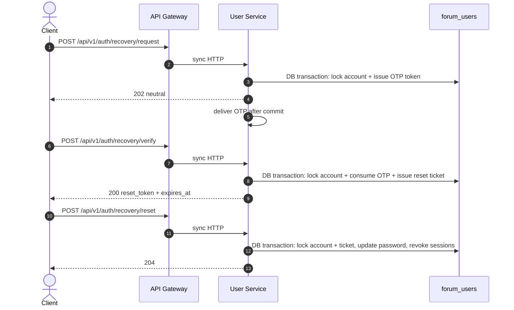

### Failure and retry

- No account / banned account / no active token → generic `400 INVALID_OTP` from verify (anti-enumeration).
- Expired/exhausted OTP → `400 OTP_EXPIRED`/`OTP_ATTEMPTS_EXCEEDED`.
- Invalid or reused reset token → `400 INVALID_RESET_TOKEN`; expired → `400 RESET_TOKEN_EXPIRED`.
- Password reuse → `400 PASSWORD_REUSE_FORBIDDEN`.
- No outbox event is emitted, so other services learn about the password change only through session invalidation.

### Known gaps

- Recovery request rate-limit code is `RATE_LIMIT_EXCEEDED`, while registration/login use `RATE_LIMITED`; the contract catalog is not consistently applied.
- Reset revokes all sessions including the caller's; the API intentionally returns `204` with no new cookie.

---

## 6. WF-04 — Profile edit and avatar lifecycle

**Trigger:** authenticated user edits profile text or uploads/removes an avatar.

**Primary contract:** `PATCH /profile` → `200`; `POST /uploads/images` → `201`; `PUT /profile/avatar` → `200`; `DELETE /profile/avatar` → `204`.

### Sequence

1. `PATCH /profile` locks the account and updates only provided `display_name`/`bio`.
2. Avatar upload first goes to Content `POST /uploads/images`: magic-byte sniff, 2 MB streamed cap, decode/normalize, fsync, then insert `attachments` with `status="pending"`.
3. `PUT /profile/avatar` calls Content `/internal/attachments/{id}/claim-avatar` with the internal key and the user ID. Content locks the attachment, verifies ownership and status, and sets `status="avatar"`.
4. User Service then locks the account, stores `avatar_object_key`, commits, and best-effort releases the previous avatar through Content `/internal/attachments/{old}/release-avatar`.
5. `DELETE /profile/avatar` clears the User reference first, then best-effort releases the Content attachment. Serving uses `GET /uploads/images/{id}` with visibility rules.

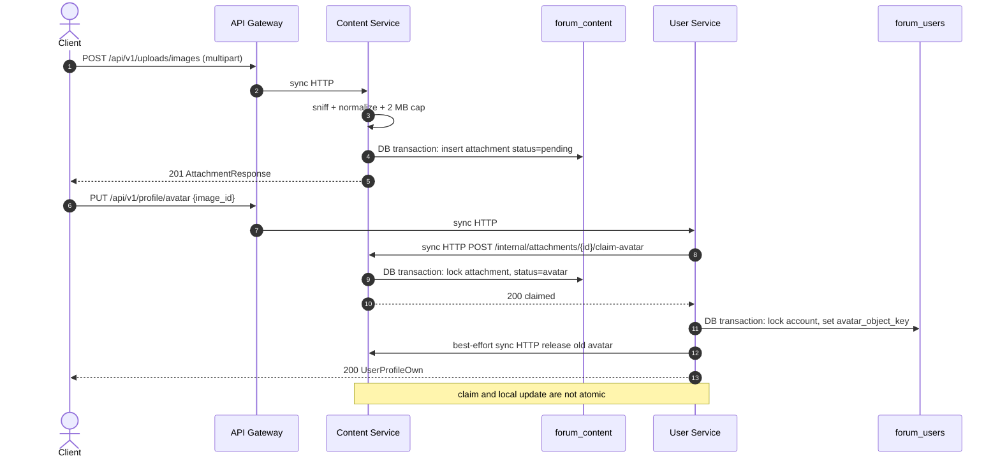

### Failure and retry

- Content claim can fail with `404`, `403`, `409`; User maps these to domain errors and aborts.
- If the User update fails after a successful claim, the attachment remains `avatar` while the account does not reference it; no compensation runs.
- Old-avatar release failures are logged and left to Content reconciliation.
- Upload failures: `415` unsupported, `413` too large, `500` storage/DB error with file cleanup on DB failure.

### Known gaps

- Cross-service avatar state is eventually consistent at best; there is no saga/compensation.
- `avatar_url` is a relative Content path, not an absolute CDN URL.

---

## 7. WF-05 — Email change

**Trigger:** authenticated user requests an email change, receives an OTP at the new address, and verifies it.

**Primary contract:** request `202`; resend `200`; verify `200` profile.

### Sequence

1. Request requires the current password, rate-limits by IP, validates the new address, rejects an unchanged address, and returns neutral `202` if another account already uses it.
2. For an eligible address, it locks the account, expires previous active requests, inserts `email_change_requests` with a 10-minute OTP, and delivers after commit.
3. Resend enforces 60-second cooldown, max 3 resends, and expiry.
4. Verify locks the account then the active request, checks expiry/attempts/OTP, re-checks uniqueness, updates `accounts.email`/`email_normalized`/`email_verified_at`, marks the request verified/completed, and maps concurrent unique violations to `409 EMAIL_ALREADY_IN_USE`.

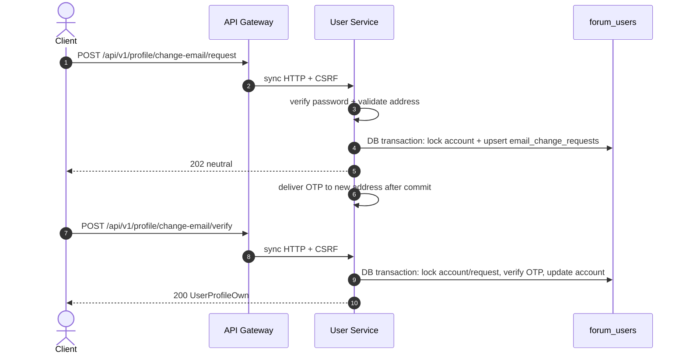

### Failure and retry

- Wrong password → `400 INVALID_PASSWORD`; same email → `400 EMAIL_UNCHANGED`; bad format → `422 VALIDATION_ERROR`.
- Cooldown → `429 RESEND_COOLDOWN_ACTIVE`; resend limit → `400 RESEND_LIMIT_EXCEEDED`; expired → `400 REQUEST_EXPIRED`.
- OTP failures → `400 INVALID_OTP`, `OTP_EXPIRED`, `OTP_ATTEMPTS_EXCEEDED`.
- Concurrent uniqueness conflict → `409 EMAIL_ALREADY_IN_USE`.
- No outbox event; Notification's email resolution uses the User internal endpoint at send time, so future notifications use the new address.

### Known gaps

- `409 EMAIL_ALREADY_IN_USE` is not documented in OpenAPI for the verify operation.
- Delivery failure marks the request completed, forcing the user to start over.

---

## 8. WF-06 — Password change

**Trigger:** authenticated user supplies current and new passwords.

**Primary contract:** `POST /profile/change-password` → `204`.

### Sequence

1. Verify the current password with the Argon2id hash.
2. Reject reuse of the current password.
3. Lock the account, append the old hash to `password_history`, update the password and `password_changed_at`.
4. Revoke every other active session with reason `password_changed`; the current session remains valid.
5. Commit and return `204`.

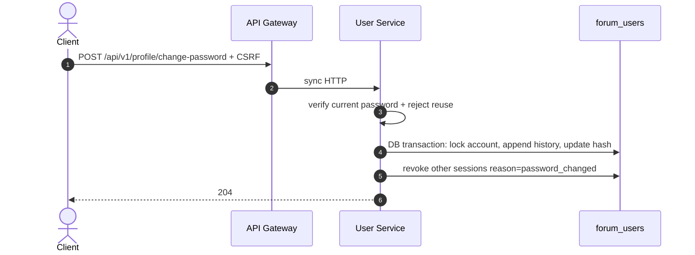

### Failure and retry

- `400 INVALID_PASSWORD`, `400 PASSWORD_REUSE_FORBIDDEN`.
- No outbox event.
- Concurrent password changes are serialized by the account row lock.

### Known gaps

- Only the current password is checked for reuse here; the reset flow checks the last 5 history entries. The change-password flow does not check history, so an older password can be reused.

---

## 9. WF-07 — Thread creation with images and indexing

**Trigger:** authenticated member uploads optional images and creates a published thread.

**Primary contract:** upload `201`; create `201 ThreadResponse`.

### Sequence

1. Client uploads each image to Content `POST /uploads/images`; each becomes a pending owned attachment.
2. Client calls `POST /threads` with `category_id`, title, body, tags, and `image_ids`.
3. Content authenticates the session, verifies the category is visible, sorts and locks the requested attachment rows `FOR UPDATE`, and rejects the request if any ID is missing, not owned, or not pending.
4. Content inserts `threads` (`status="published"`, flags false, `view_count=0`), inserts normalized/deduplicated `thread_tags`, marks attachments `linked` with `linked_at`, and inserts `ThreadCreated` in the same transaction.
5. After commit, the Content outbox worker delivers `ThreadCreated` to Search and Notification.
6. Search upserts a `documents` row and indexes the title, body (if present), tags, category, author, and visibility.
7. Notification ignores `ThreadCreated` because it is not in `SUPPORTED_EVENTS`.

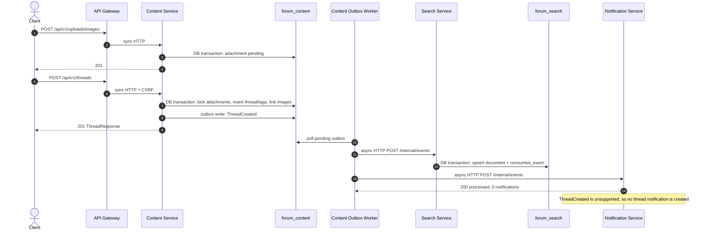

### Data effects

- `threads`, `thread_tags`, `attachments` (`status`, `thread_id`, `linked_at`), `outbox_events`.
- Search `documents` and `consumed_events`.

### Failure and retry

- Invalid attachment set → `400 INVALID_ATTACHMENT`; the thread is not committed.
- Hidden/missing category → `404 CATEGORY_NOT_FOUND`.
- Outbox delivery retries independently for Search and Notification. A failure to either target marks the whole event failed, so both consumers may receive duplicates; both are idempotent by `event_id`.
- If Content emits `ThreadCreated` without `body`, Search stores an empty body; this is a producer/consumer payload gap, not a delivery failure.

### Known gaps

- `Idempotency-Key` is accepted by OpenAPI but ignored; retries create duplicate threads and duplicate attachment links (the second attempt will fail `INVALID_ATTACHMENT` because attachments are no longer pending).
- `ThreadCreated` is routed to Notification but unsupported.
- Notification's `ThreadCreated` support would need a recipient and content fields that Content does not emit.
- Search's `ThreadCreated` handler cannot index body because the payload omits it.

---

## 10. WF-08 — Browse, thread detail, view tracking

**Trigger:** visitors list threads, open a thread, and the client records a view.

**Primary contract:** list `200 ThreadPageResponse`; detail `200 ThreadResponse`; view `204`.

### Sequence

1. `GET /threads` selects published threads, applies category/tag filters, orders by pinned then `created_at` (or `view_count` for `most_viewed`), and pages by timestamp cursor.
2. `GET /threads/{id}` returns the thread and tags unless status is `deleted` or `hidden`.
3. `POST /threads/{id}/view` is public. Interaction first calls Content `GET /threads/{id}` to verify visibility.
4. Interaction computes a deduplication key: HMAC of the session cookie when present, otherwise HMAC of the client IP. It checks `thread_views` for a view within the 30-minute window.
5. If already viewed, it returns `204` without an event. Otherwise it inserts/refreshes `thread_views`, inserts `ThreadViewCountIncremented` in the same transaction, and returns `204`.
6. The Interaction outbox worker delivers the event to Content and Search. Both update their local view counters idempotently by `event_id`.

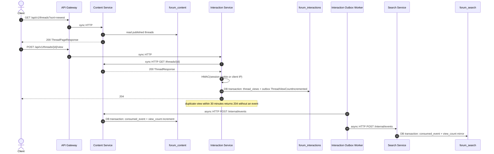

### Failure and retry

- Content verification failure → `404 THREAD_NOT_FOUND`, `400 INVALID_TARGET`, or `503`.
- Concurrent first views for the same key → `IntegrityError` mapped to `204` (deduplicated).
- Event delivery is at-least-once; Content and Search both deduplicate by `event_id`.
- `view_count` is eventually consistent: Content's displayed count may lag the event.

### Known gaps

- `GET /threads?sort=most_voted` accepts the value but orders by newest; no vote aggregation is joined.
- `GET /threads` timestamp-only cursors can skip/duplicate rows with equal timestamps.
- Search `most_viewed` ordering uses `source_created_at` for its cursor even though ordering is by `view_count`, so pagination is unstable.
- View deduplication by IP can undercount users behind a shared NAT; by cookie it can inflate views after cookie rotation.

---

## 11. WF-09 — Thread edit, delete, lock, pin, best answer

**Trigger:** owner edits/deletes; moderator locks/pins; owner selects a best answer.

**Primary contract:** edit `200`; delete `204`; lock/pin `200`; best answer `200`.

### Sequence

1. Edit authenticates, loads the thread, permits the author or a moderator/admin, updates title/body, replaces tags if provided, sets `edited_at`, and writes `ThreadUpdated` in the same transaction.
2. Delete authenticates, allows the author or a moderator/admin, and for a non-moderator owner rejects deletion if a best answer exists or any non-deleted comment exists (`409 THREAD_REQUIRES_MODERATION`). On success it sets `status="deleted"` and writes `ThreadDeleted`.
3. Lock/pin require `admin` or `moderator`, set the boolean, and write `ThreadLockToggled`/`ThreadPinToggled`.
4. Best answer requires the thread owner, verifies the comment belongs to the thread and is not deleted, sets `best_answer_comment_id`, and writes `BestAnswerChanged`.
5. The outbox worker delivers to Search and, for `BestAnswerChanged`, to Notification. Notification notifies the comment author.

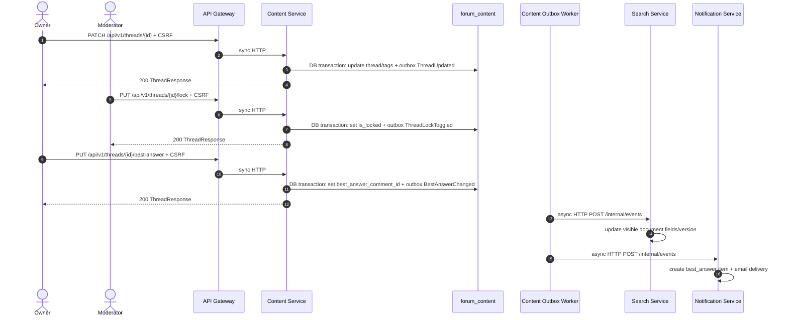

### Failure and retry

- Non-owner/non-moderator edit/delete → `403`.
- Owner delete with comments/best answer → `409 THREAD_REQUIRES_MODERATION`.
- Missing/deleted thread → `404`.
- Best answer for a comment from another thread/deleted → `400 INVALID_COMMENT`.
- Outbox retries are independent; Search and Notification deduplicate by `event_id`.

### Known gaps

- `ThreadUpdated` payload omits `body`, `tags`, and `category_id`; Search only updates title/status and leaves body/tags/category stale.
- Best-answer does not enforce the ADR requirement that the thread belong to a Q&A category or be unlocked.
- `BestAnswerChanged` is routed only to Notification; the contract lists Interaction as a consumer for reputation, but Interaction has no handler.
- Deleting the selected best-answer comment does not clear `threads.best_answer_comment_id`.
- `ThreadLockToggled`/`ThreadPinToggled` bump Search version but do not store pin/lock state, so search ordering cannot reflect pins.

---

## 12. WF-10 — Comment lifecycle

**Trigger:** member views/creates comments; owner or moderator edits/deletes.

**Primary contract:** list `200`; create `201`; edit `200`; delete `204`.

### Sequence

1. Listing verifies the thread is visible, selects comments ascending, and includes deleted comments with `[deleted]`.
2. Creation authenticates, verifies the thread is not deleted/hidden, rejects locked threads, validates the parent (exists, same thread, depth ≤2), inserts the comment, and writes `CommentCreated` in the same transaction.
3. Edit authenticates, loads a non-deleted comment, permits the author or moderator/admin, updates body/`edited_at`, and writes `CommentUpdated`.
4. Delete authenticates, permits the author or moderator/admin, sets `is_deleted=True`, and writes `CommentDeleted`.
5. The outbox worker routes `CommentCreated` to Notification. `CommentUpdated` and `CommentDeleted` are absent from the routing table, so the worker marks them delivered without calling any consumer.

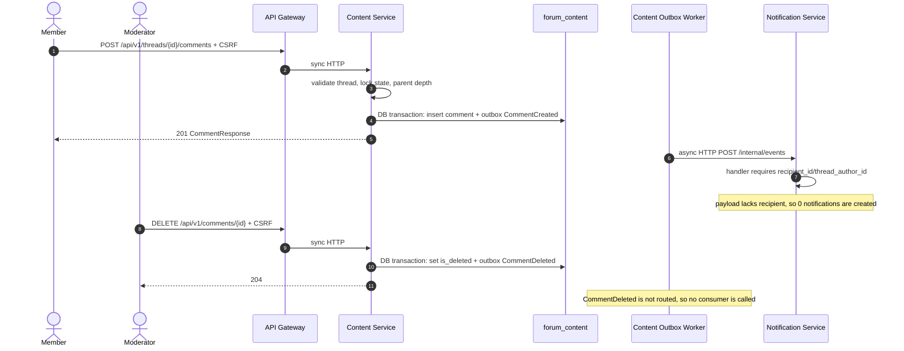

### Failure and retry

- Locked thread → `409 THREAD_LOCKED`.
- Missing thread/parent → `404`.
- Cross-thread parent or depth >2 → `400`.
- Deleted comment edit/delete → `404`.
- No consumer retry for `CommentUpdated`/`CommentDeleted` because they are marked delivered immediately.

### Known gaps

- **Comment notifications never fire:** Content emits `comment_id`, `thread_id`, `author_id`, `parent_comment_id`; Notification requires `recipient_id` or `thread_author_id`.
- `CommentCreated` is not subscribed by Search; comment content is not indexed.
- `Idempotency-Key` is ignored on creation.
- `CommentUpdated`/`CommentDeleted` are not in `EVENT_ROUTING_TABLE`, so they are effectively no-op events.
- Deleting a comment does not clear a best-answer reference.

---

## 13. WF-11 — Voting, reputation, and vote notifications

**Trigger:** member votes on a thread or comment.

**Primary contract:** thread vote `200 VoteResponse`; comment vote `200 VoteResponse`.

### Sequence

1. Both vote endpoints validate `value` is `1` or `-1`.
2. Thread vote calls Content `GET /threads/{id}` to verify existence/visibility, extracts `author_id`, and rejects self-votes.
3. In one Interaction transaction: select the existing vote; toggle off if same value, change value if different, or insert a new vote; recompute the aggregate score; upsert `reputation_ledger` for the target author (thread votes only); write `VoteChanged`.
4. Reputation deltas: new thread vote ±5, flip ±10, cancel reverses the prior grant. Comment votes use ±2/±4 in the response but do not write a ledger row.
5. The outbox worker delivers `VoteChanged` to Notification. Notification creates an `upvote` item only when `my_vote == 1`, excludes self-votes, and does not send email.

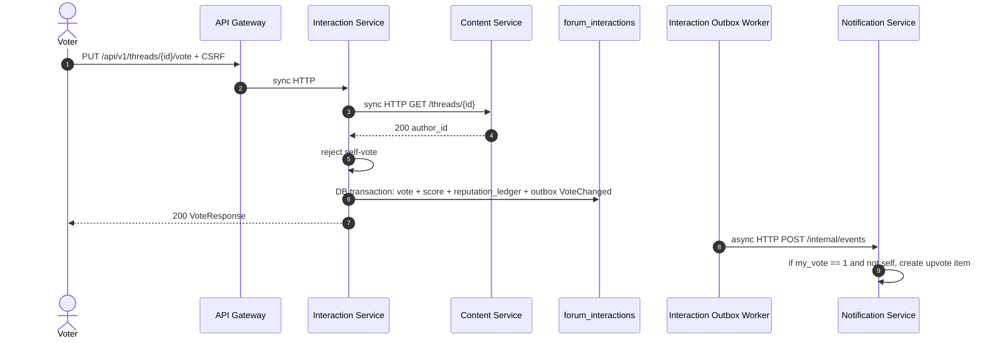

### Failure and retry

- Invalid value → `422 VALIDATION_ERROR`.
- Nonexistent thread → `404`; Content unreachable → `503`.
- Self-vote → `400 SELF_VOTE_NOT_ALLOWED`.
- Concurrent vote races → `409 CONFLICT` for thread votes.
- Outbox delivery retries; Notification deduplicates by `(event_id, recipient_id)`.

### Known gaps

- `PUT /comments/{id}/vote` does **not** verify the comment exists or belongs to a real thread, and does **not** prevent self-voting. It can create votes for arbitrary UUIDs.
- Comment vote deltas are returned but no `reputation_ledger` row is written, so `GET /users/{id}/reputation` does not reflect comment votes.
- `VoteChanged` for comments omits `author_id`, so Notification cannot notify the comment author.
- Vote score is recomputed by `SUM(votes.value)`; comment votes are not validated against Content, so orphan votes remain in the aggregate.

---

## 14. WF-12 — Bookmarks and reputation read

**Trigger:** member bookmarks/unbookmarks threads and lists bookmarks; anyone reads reputation.

**Primary contract:** bookmark `200`; unbookmark `204`; list `200`; reputation `200`.

### Sequence

1. Bookmark authenticates, verifies the thread through Content `GET /threads/{id}`, then inserts a `bookmarks` row if absent. A concurrent unique-constraint violation is treated as success.
2. Unbookmark deletes the current user's bookmark if present, without a Content check.
3. Listing pages the user's bookmarks by `created_at DESC`, then synchronously fetches each thread from Content. Deleted, hidden, or unreachable threads are replaced with a synthetic placeholder representation.
4. Reputation sums `reputation_ledger.delta` for the requested user; an unknown UUID returns 0.

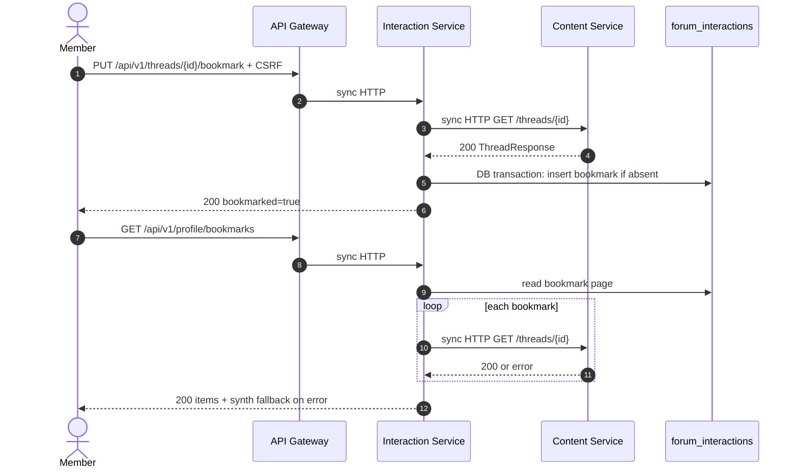

### Failure and retry

- Bookmark target missing → `404`; Content unreachable → `503`.
- Repeated bookmark calls are idempotent; unbookmark of a missing row is a no-op.
- Bookmark listing degrades to placeholders rather than failing when Content errors.
- No events; no outbox.

### Known gaps

- Bookmark list performs N+1 synchronous calls and can return invented placeholder thread data with a fake `category_id`/author/body.
- Reputation returns 0 for nonexistent users instead of `404`.
- Comment votes do not contribute to reputation (see WF-11).

---

## 15. WF-13 — Abuse report submission

**Trigger:** member reports a thread, comment, or account.

**Primary contract:** `POST /reports` → `201`; `GET /reports/mine` → `200`.

### Sequence

1. Reject self-reporting for account targets.
2. Verify the target through the owning service:
   - thread → Content `GET /threads/{id}`;
   - comment → Content `GET /comments/{id}`;
   - account → User `GET /users/{id}`.
3. Check for an active duplicate report by the same reporter for the same target (`pending`/`reviewing`).
4. Insert a `reports` row with `status="pending"`, the appropriate target FK column, reason, and details.
5. `GET /reports/mine` pages the reporter's own reports.

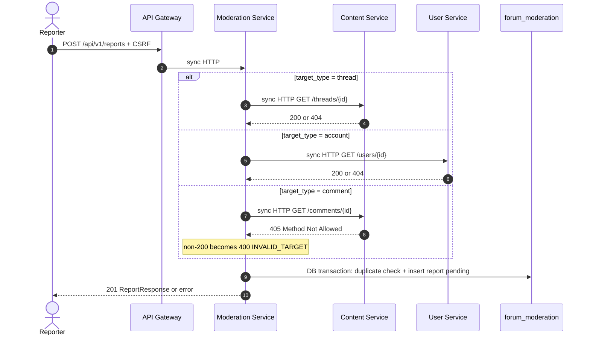

### Failure and retry

- Self-report → `400 SELF_REPORT_NOT_ALLOWED`.
- Unknown target → `404 TARGET_NOT_FOUND`.
- Duplicate active report → `409 DUPLICATE_REPORT`.
- Target service unreachable → `503`.
- No outbox event; moderators discover reports by polling the queue.

### Known gaps

- **Comment reports cannot be created:** Content has no `GET /comments/{id}` route. FastAPI returns `405`, which Moderation maps to `400 INVALID_TARGET`.
- `Idempotency-Key` is accepted but unused; duplicate protection is only the active-report check.
- No notification is sent to moderators or the reporter when a report is created.
- Report target verification is a synchronous hard dependency; Content/User outages block reporting.

---

## 16. WF-14 — Moderation queue and enforcement

**Trigger:** moderator claims a report, applies an action, or applies a proactive action.

**Primary contract:** queue/detail `200`; claim `PATCH /review` (extra route) `200`; report action `200`; proactive action `200`; audit list `200`.

### Sequence

1. Queue listing filters by status/target and pages by `created_at`.
2. Claim (`PATCH /moderation/reports/{id}/review`) locks the report and requires `pending`, then sets `reviewing` and `assigned_to`.
3. Report action locks the report and rejects already finalized states.
4. `dismiss_report` marks the report `dismissed`, writes an `actions` row, and emits `ModerationActionApplied`.
5. Other actions call Content/User synchronously with the moderator's forwarded cookie and CSRF token:
   - lock/pin → Content thread endpoints;
   - soft_delete → Content DELETE thread/comment;
   - ban/unban/role_change → User admin endpoints;
   - move_category → Content `PATCH /threads/{id}` with `category_id`.
6. On remote success, Moderation marks the report `actioned`, writes `actions`, and emits `ModerationActionApplied` in the local transaction. On failure, it writes a failed `actions` audit row and returns `400 ACTION_FAILED` without finalizing the report.
7. The outbox worker delivers `ModerationActionApplied` to Search and Notification. Search hides/unhides thread documents for delete/hide/restore; Notification sends moderation email for account-target actions.

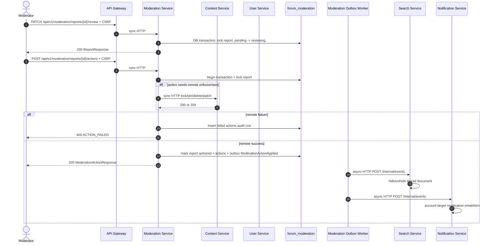

### Failure and retry

- Finalized report → `409 REPORT_ALREADY_FINALIZED`.
- Invalid claim transition → `409 INVALID_STATE_TRANSITION`.
- Remote action failure → `400 ACTION_FAILED`, report remains unactioned, failed audit row persists.
- Moderation holds the report row lock while performing the remote HTTP call; long Content/User calls increase lock contention.
- Outbox retry is at-least-once; Search/Notification deduplicate by `event_id`.

### Known gaps

- **`move_category` is a no-op:** Content's `EditThreadRequest` has no `category_id`; the PATCH returns `200` and Moderation marks the report actioned even though the thread did not move.
- Remote enforcement and local report finalization are not atomic. A local DB failure after a successful remote ban/delete leaves the external effect applied without a successful audit/outbox record.
- `role_change` requires an admin caller at User Service, but Moderation allows moderators; a moderator's role-change action fails with `400 ACTION_FAILED`.
- Notification receives `ModerationActionApplied` but Moderation's payload has no `affected_user_id`/`author_id` for thread/comment targets, so only account-target actions resolve a recipient.
- Proactive action executes the remote call before opening the local transaction.
- No claim-release or reassignment endpoint; a moderator can claim a report and leave it `reviewing` indefinitely.

---

## 17. WF-15 — Notification inbox, preferences, and email delivery

**Trigger:** user opens notifications, changes preferences, or marks items read; background workers deliver emails.

**Primary contract:** list `200`; unread count `200`; mark read `200`; read-all `204`; preferences get/patch `200`.

### Sequence

1. Inbox listing selects own notifications, optional `unread_only`, deterministic `(created_at, id)` cursor.
2. Detail/mark-read enforce `recipient_id=current_user`; mark-read is idempotent and sets `read_at` on first transition.
3. Read-all marks every unread own item read.
4. Preferences get/patch normally use the authenticated user. Source also allows anonymous access via `DEFAULT_USER_ID`, and patch applies CSRF only when a cookie exists.
5. Event ingestion creates in-app items and email deliveries. The email worker claims pending rows, dispatches outside the transaction, and records delivered/failed/dead-letter.
6. Stale `sending` leases are recovered on startup and periodically; crash-after-SMTP-accept can duplicate delivery.

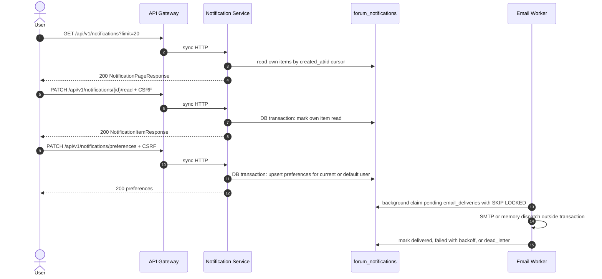

### Failure and retry

- Unauthenticated list/detail/mark-read → `401` from User session validation.
- Cross-user notification access → `404` because queries include the recipient filter.
- Email failure retries with exponential backoff/jitter; recipient rejection or max attempts → `dead_letter`.
- Allowlist rejection in dev/test → immediate `dead_letter`.
- Email address resolution failure skips email but still records the event as consumed.

### Known gaps

- **Anonymous behavior:** `GET /notifications/unread-count` returns `200 {unread_count:0}` and preferences endpoints return/update `DEFAULT_USER_ID` without authentication, while OpenAPI declares session auth and `401`.
- `PATCH /notifications/preferences` can be called anonymously without CSRF when no cookie is present, mutating shared default-user state.
- `POST /notifications/read-all` returns `204` with a JSON `null` body from `JSONResponse(content=None)`.
- Comment notifications never fire (WF-10).
- Thread-created notifications never fire (`ThreadCreated` unsupported).
- Thread/comment moderation notifications generally do not resolve a recipient (WF-14).
- Email delivery is at-least-once; duplicates are possible after a crash between SMTP acceptance and DB commit.

---

## 18. WF-16 — Search query, suggestions, and reindex

**Trigger:** public search/suggestions, or an admin reindexes the index.

**Primary contract:** search `200 SearchPage`; suggestions `200`; reindex `200` (extra route).

### Sequence

1. Suggestions require `q` of at least 2 characters and return distinct visible titles matching `ILIKE`.
2. Search selects visible documents and applies category/tag/substring filters. Sorting is `relevance` (default `indexed_at DESC`), `newest` (`source_created_at DESC`), or `most_viewed` (`view_count DESC`).
3. Pagination uses the corresponding timestamp cursor; `most_viewed` still uses `source_created_at`, not `view_count`.
4. `POST /admin/reindex` requires an admin session and a valid CSRF token. It synchronously fetches Content `GET /threads?limit=50`, upserts each document, and returns the count.
5. Normal index maintenance is async: Content/Interaction/Moderation outbox events are delivered to Search `/internal/events`, which deduplicates by `event_id` and upserts/updates documents.

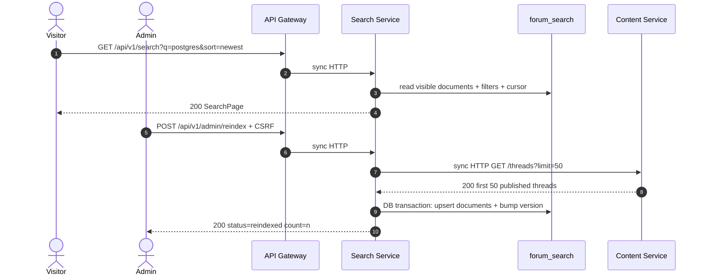

### Failure and retry

- Invalid `q` for suggestions → `422` (min length).
- Invalid sort → `422` (regex pattern).
- Content unavailable during reindex → `503`; non-200 → `502`.
- Event delivery retries via outbox; Search deduplicates by `event_id`.
- Search is eventually consistent; no synchronous index update on Content mutations.

### Known gaps

- Substring `ILIKE`, not PostgreSQL full-text search; no ranking/relevance scoring.
- `most_viewed` pagination is unstable because the cursor is a timestamp while ordering is by view count.
- `POST /admin/reindex` only reconciles the first 50 threads; it does not loop through cursor pages.
- Search does not consume `CommentCreated`, `BestAnswerChanged`, or `VoteChanged`.
- `ThreadCreated` indexes an empty body; `ThreadUpdated` does not refresh body/tags/category.
- No stale-event ordering guard; a late-arriving older event can overwrite newer document fields, although most handlers only bump version/timestamps.

---

## 19. WF-17 — Admin user management

**Trigger:** admin lists users, changes roles; admin/moderator bans or unbans.

**Primary contract:** list `200`; role change `200`; ban/unban is an extra public route `200`.

### Sequence

1. `GET /admin/users` requires role `admin`, reads accounts ordered by `created_at DESC`, and returns `{items, next_cursor:null}`.
2. Role change requires `admin`, locks/selects the account, updates the role, revokes all active sessions with reason `role_change`, and returns the admin view.
3. Ban/unban requires `admin` or `moderator`, updates `is_banned`/`ban_reason`, revokes sessions when banning, and returns the admin view.

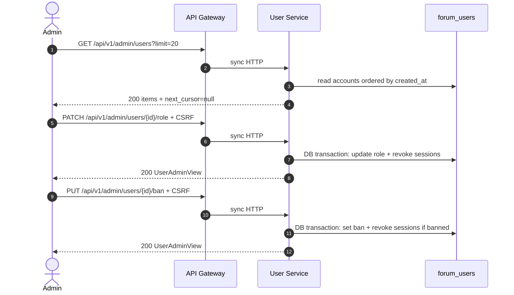

### Failure and retry

- Non-admin on list/role → `403`; non-admin/moderator on ban → `403`.
- Missing user → `404 USER_NOT_FOUND`.
- Role change revokes the target's sessions immediately; the admin's own session is unaffected unless self-targeted.
- No outbox events; other services learn about bans only when they next validate the session.

### Known gaps

- `search` and `role` query filters documented in OpenAPI are ignored.
- Cursor pagination is not implemented; `next_cursor` is always `null`, so callers cannot page beyond `limit`.
- No audit event/outbox for role or ban changes.
- An admin can ban themselves or demote the last admin; no guard exists in source.

---

## 20. WF-18 — Generic outbox delivery, retry, and dead-letter

**Trigger:** any producer commits a domain event; the service-local outbox worker polls.

**Scope:** User, Content, Interaction, Moderation outbox tables (`outbox_events`).

### State machine

| State | Meaning | Transition |
|---|---|---|
| `pending` | Committed, not yet claimed | Worker claims with `FOR UPDATE SKIP LOCKED`, sets `processing`. |
| `processing` | Leased to a worker | Success → `delivered`; failure → `failed` with backoff or `dead_letter`; stale lease → reclaimed. |
| `failed` | Retry scheduled after a transient error | Claimed again when `next_retry_at <= now`. |
| `delivered` | All target consumers returned success | Terminal. Late updates are ignored. |
| `dead_letter` | Max attempts reached or permanent 4xx | Terminal; requires operator action. |

### Sequence

1. Business handler writes domain rows and the outbox row in one local transaction.
2. Worker claims a batch (default 20), ordered by `occurred_at`, using `SELECT ... FOR UPDATE SKIP LOCKED` on PostgreSQL.
3. Worker posts the canonical envelope to each target in `EVENT_ROUTING_TABLE`:
   `{event_id, event_type, occurred_at, producer, data}` with `X-Internal-Service-Key`.
4. Consumers must be idempotent by `event_id`; Notification additionally keys by `(event_id, recipient_id)`.
5. Worker records `delivered` only if every target returns `< 400`.
6. Transient failures retry with exponential backoff and jitter (base 2 s, cap 60 s, max 5 attempts). A permanent 4xx other than 408/429 goes straight to `dead_letter`.

```mermaid
sequenceDiagram
    autonumber
    participant Producer as Producer Service
    participant PDB as producer database
    participant OW as Outbox Worker
    participant C1 as Consumer 1
    participant C2 as Consumer 2
    participant CDB as consumer databases

    Producer->>PDB: DB transaction: business rows + outbox pending
    OW->>PDB: claim batch FOR UPDATE SKIP LOCKED
    OW->>PDB: mark processing + lease locked_by
    OW->>C1: async HTTP POST /internal/events
    C1->>CDB: DB transaction: idempotency check + apply + consumed_event
    C1-->>OW: 200
    OW->>C2: async HTTP POST /internal/events
    alt all targets succeed
        C2->>CDB: DB transaction: idempotency + apply
        C2-->>OW: 200
        OW->>PDB: delivered
    else one target fails
        C2-->>OW: 5xx or timeout
        OW->>PDB: failed with next_retry_at and last_error
        Note over OW: retries up to 5 attempts, then dead_letter
        Note over C1: already applied C1 side; duplicate delivery is safe if idempotent
    end
```

### Routing matrix

| Event | Consumers |
|---|---|
| `ThreadCreated` | Search, Notification |
| `ThreadUpdated` | Search |
| `ThreadDeleted` | Search |
| `ThreadLockToggled` | Search |
| `ThreadPinToggled` | Search |
| `CommentCreated` | Notification |
| `BestAnswerChanged` | Notification |
| `VoteChanged` | Notification |
| `ThreadViewCountIncremented` | Content, Search |
| `ModerationActionApplied` | Search, Notification |
| `UserRegistered` | Notification |

### Failure and retry

- Consumer 5xx/timeout → retry with backoff.
- Consumer 4xx except 408/429 → immediate `dead_letter`.
- Stale `processing` leases are reclaimed after 60 seconds; the stale worker's late status update is rejected by `locked_by` comparison.
- Multi-target delivery is not atomic: one consumer can apply an event while another fails; retry redelivers to both, so all consumers must be idempotent.
- No operator-facing replay API exists in source; dead-letter recovery would be manual.

### Known gaps

- `CommentUpdated` and `CommentDeleted` are not in the routing table, so they are marked `delivered` without any consumer.
- `ThreadCreated` is routed to Notification, which does not support it.
- Event payloads are not schema-versioned in the envelope; the contract's `schema_version` field is absent from the worker envelope.
- No dead-letter alerting or admin replay endpoint.

---

## 21. WF-19 — Email dispatch, lease recovery, and dead-letter

**Trigger:** Notification event ingestion creates `email_deliveries` rows; the email worker polls.

**Scope:** `forum_notifications.email_deliveries`.

### Sequence

1. Event handler determines whether email is mandatory (welcome/moderation) or optional (comment/best answer), checks `email_enabled`, and resolves the recipient address from the event or User Service internal endpoint.
2. Worker claims pending/failed rows whose `next_attempt_at <= now` and `attempts < max_attempts`, using `SKIP LOCKED`; sets `sending` + `sending_since` lease.
3. Worker dispatches via SMTP or memory **outside** the DB transaction.
4. Success → `delivered`, `delivered_at`, clear error/lease. Failure → `failed` with backoff, or `dead_letter` on recipient rejection/max attempts.
5. On startup and periodically, stale `sending` leases are recovered: attempts increment, then `failed` with backoff or `dead_letter`.

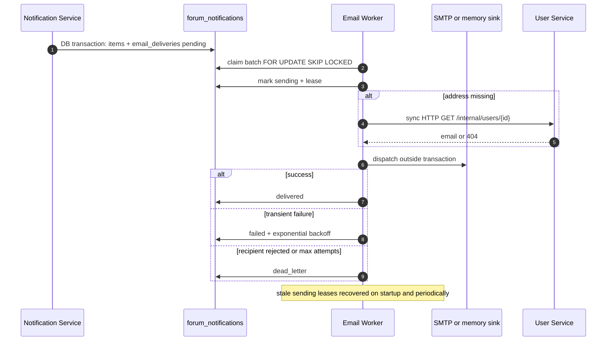

### Failure and retry

- Max attempts default 5; backoff base 2 s, cap 60 s, jitter 0.5–1.5×.
- Allowlist rejection in dev/test is treated as permanent (`dead_letter`).
- Crash after SMTP acceptance before DB commit can resend: at-least-once.
- No exactly-once guarantee; no deduplication key beyond the delivery row.
- No admin replay/requeue API.

### Known gaps

- `email_deliveries` has no unique constraint preventing duplicate rows for the same event/recipient if ingestion is retried before `consumed_events` is visible; idempotency relies on the event transaction.
- No bounce/complaint handling beyond SMTP recipient rejection.
- No operator endpoint to inspect or replay dead-letter emails (metrics/logs only).

---

## 22. WF-20 — Gateway request pipeline and error handling

**Trigger:** every public API call.

**Primary contract:** transparent proxy plus `ROUTE_NOT_FOUND` and canonical Gateway failures.

### Sequence

1. Read/generate `X-Request-ID` (client value accepted if ≤128 chars).
2. Resolve the path through ordered router rules.
3. Unknown prefix → `404 ROUTE_NOT_FOUND`.
4. Uninitialized client → `503 GATEWAY_UNAVAILABLE`.
5. Strip hop-by-hop and spoofable identity/internal headers; remove `Content-Length`; add canonical `X-Request-ID`.
6. Reject declared `Content-Length > 5 MB` before reading; otherwise stream with a cumulative 5 MB cap.
7. Stream upstream response, preserve `Set-Cookie`, map failures.

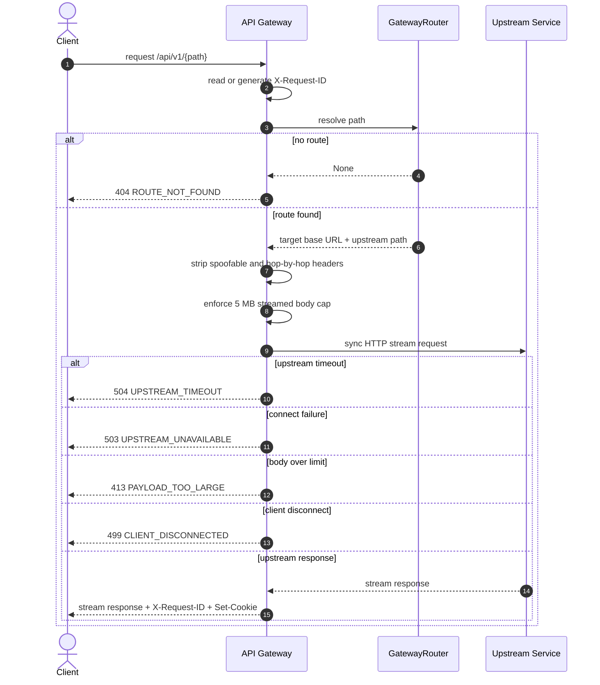

### Failure and retry

- The Gateway does not retry requests; a timeout after the body has begun streaming is not replayed.
- A 413 detected mid-stream aborts the upstream request; the upstream may have received a partial body.
- Client disconnect maps to `499` and closes the upstream stream.
- Unknown/unexpected forwarding errors map to `502`.

### Known gaps

- No Gateway-level rate limiting, authentication, or CSRF enforcement despite the contract's descriptive text; those are implemented in services.
- The Gateway readiness probe does not check downstream services.
- `/metrics` and `/health/*` are public.
- The catch-all accepts `OPTIONS`/`HEAD`; service CORS behavior is not configured centrally in the Gateway source.

---

## 23. Cross-workflow gap matrix

Severity: **High** = feature broken or security/contract violation; **Medium** = degraded behavior or missing documented option; **Low** = cosmetic/consistency issue.

| ID | Area | Gap | Source evidence | User-visible impact | Severity | Status |
|---|---|---|---|---|---|---|
| GAP-01 | Reports | Comment report verification calls nonexistent `GET /comments/{id}` | `moderation/app.py` target verification; `content/app.py` has no GET comment route | Comment reports always fail with `400 INVALID_TARGET` | High | `PARTIALLY_IMPLEMENTED` |
| GAP-02 | Moderation | `move_category` sends `category_id` to a schema that ignores it | `moderation/app.py execute_remote_action`; `content/schemas.py EditThreadRequest` | Report marked actioned; thread does not move | High | `PARTIALLY_IMPLEMENTED` |
| GAP-03 | Notifications | `CommentCreated` payload lacks recipient/thread author | `content/app.py` payload; `notification/events.py` recipient lookup | No comment notifications are ever created | High | `PARTIALLY_IMPLEMENTED` |
| GAP-04 | Idempotency | `Idempotency-Key` declared but unused | OpenAPI parameters; Content thread/comment handlers; Moderation report handler | Retries duplicate threads/comments/reports | High | `PARTIALLY_IMPLEMENTED` |
| GAP-05 | Notification auth | Anonymous unread-count/preferences access and anonymous preference mutation | `notification/app.py` optional user + `DEFAULT_USER_ID` | Contract says `401`; anonymous callers can read/update shared defaults | High | `CONTRACT_SOURCE_MISMATCH` |
| GAP-06 | Comment votes | No target verification or self-vote check; no reputation ledger | `interaction/app.py vote_comment` | Votes on nonexistent comments; self-voting; reputation not updated | High | `PARTIALLY_IMPLEMENTED` |
| GAP-07 | User admin | `search`/`role` filters ignored; no cursor pagination | `user/app.py admin_list_users` | Admins cannot filter or page users | Medium | `PARTIALLY_IMPLEMENTED` |
| GAP-08 | Thread list | `most_voted` accepted but not implemented | `content/app.py list_threads` | Sort silently falls back to newest | Medium | `PARTIALLY_IMPLEMENTED` |
| GAP-09 | Best answer | No Q&A-category or lock check; Interaction does not consume event | `content/app.py set_best_answer`; routing table | Non-Q&A/locked threads can select best answer; no reputation event | Medium | `PARTIALLY_IMPLEMENTED` |
| GAP-10 | Search indexing | `ThreadCreated` omits body; `ThreadUpdated` omits body/tags/category; no comment/vote/best-answer consumption | `content/app.py` payloads; `search/events.py` | Search results have empty/stale body and tags; discussions not reindexed on comments/votes | Medium | `PARTIALLY_IMPLEMENTED` |
| GAP-11 | Search reindex | Only first 50 threads fetched | `search/app.py trigger_reindex` | Index reconciliation misses most threads | Medium | `PARTIALLY_IMPLEMENTED` |
| GAP-12 | Search pagination | `most_viewed` cursor uses timestamp | `search/app.py search_threads` | Duplicate/skipped results while paging | Medium | `PARTIALLY_IMPLEMENTED` |
| GAP-13 | Outbox | `CommentUpdated`/`CommentDeleted` unrouted; `ThreadCreated` routed to unsupported Notification | `outbox_worker.py EVENT_ROUTING_TABLE`; `notification/events.py SUPPORTED_EVENTS` | Edits/deletes produce no downstream effect; thread-created event wasted | Medium | `PARTIALLY_IMPLEMENTED` |
| GAP-14 | Moderation notification | Payload lacks affected user/author for thread/comment actions | `moderation/app.py` outbox payload; `notification/events.py` | Moderated thread/comment authors are not notified | Medium | `PARTIALLY_IMPLEMENTED` |
| GAP-15 | Avatar consistency | Claim and local User update are not atomic; release is best-effort | `user/app.py set_avatar/delete_avatar` | Orphaned avatar attachments or stale references after failures | Medium | `PARTIALLY_IMPLEMENTED` |
| GAP-16 | Password change | Does not check the last 5 password history entries | `user/app.py change_password` vs `recovery_reset` | Older password can be reused through profile change | Medium | `IMPLEMENTED` with policy gap |
| GAP-17 | Reports/Moderation | No outbox event for report creation; moderators poll | `moderation/app.py create_report` | No real-time moderation notification | Low | `IMPLEMENTED` |
| GAP-18 | Gateway | No central rate limiting/auth/CSRF despite contract text | `gateway/app.py`, `forwarder.py` | Defenses rely entirely on services | Low | `IMPLEMENTED` with doc mismatch |
| GAP-19 | OpenAPI surface | Five public routes absent; one query param extension absent | OpenAPI paths; extra handlers | SDK/clients generated from OpenAPI cannot call extras | Medium | `IMPLEMENTED` but undocumented |
| GAP-20 | Error codes | `ACCOUNT_BANNED` vs `ACCOUNT_RESTRICTED`; mixed rate-limit codes | `user/app.py`; contract catalog | Client error handling inconsistency | Low | `IMPLEMENTED` with inconsistency |
| GAP-21 | 204 bodies | `read-all` uses `JSONResponse(content=None)` | `notification/app.py` | Some clients may parse `null` on a 204 | Low | `IMPLEMENTED` with minor mismatch |
| GAP-22 | Bookmark list | N+1 calls and synthetic placeholder threads | `interaction/app.py list_own_bookmarks` | Fake thread data can appear in UI when Content fails | Medium | `IMPLEMENTED` with degraded behavior |
| GAP-23 | Reputation | Unknown user returns 0; comment votes excluded | `interaction/app.py` | Reputation is incomplete/misleading | Medium | `PARTIALLY_IMPLEMENTED` |
| GAP-24 | Outbox envelope | No `schema_version`; no replay API | `outbox_worker.py` payload | Contract mismatch; manual dead-letter recovery only | Low | `IMPLEMENTED` with contract gap |
| GAP-25 | Admin safety | No guard against self-ban or removing the last admin | `user/app.py admin_ban_user/admin_change_user_role` | Admin lockout possible | Medium | `IMPLEMENTED` with policy gap |

---

## 24. Contract-to-source reconciliation summary

The canonical API contract (`src/docs/forum_api_contract.md`) and OpenAPI describe a broader surface than the source in several places:

1. **Idempotency (ADR-014 / contract §2):** documented for thread/comment/report creation; not implemented. Duplicate-report protection exists independently.
2. **Notification authentication:** contract requires session auth; source permits anonymous unread-count/preferences and anonymous preference mutation.
3. **Comment reporting:** contract supports comment targets; source cannot verify them.
4. **Moderation lifecycle:** contract implies category moves and complete enforcement; source's `move_category` is a no-op and enforcement/local audit are not atomic.
5. **Search consistency (ADR-012):** contract targets index freshness within 60 seconds; source has no ordering guard, incomplete payloads, and no comment/vote/best-answer indexing.
6. **Best-answer rules:** contract requires Q&A category and unlocked thread; source enforces neither.
7. **Vote integrity:** contract disallows self-votes and implies target verification; comment voting enforces neither.
8. **Notifications:** contract implies comment/vote/best-answer notifications; source cannot create comment notifications and only partially handles moderation notifications.
9. **Admin user listing:** contract documents `search`/`role` filters and cursor pagination; source implements neither.
10. **Public route inventory:** five routes are reachable but absent from OpenAPI; one Notification query parameter (`unread_only`) is implemented but undocumented.

These are behavior/contract gaps, not merely documentation omissions. Fixing them requires source changes outside the scope of this documentation task.

---

## 25. Validation checklist for this document set

Documentation-only validation performed:

- [x] Every canonical OpenAPI method/path appears in the endpoint reference (60/60).
- [x] Every additional public Gateway route is listed (5/5).
- [x] Every internal service route is listed (6/6).
- [x] Every endpoint has exactly one status from the defined set.
- [x] Every endpoint records fields A–F (identity/routing, auth/CSRF/RBAC, request, response, processing/DB, events/failures).
- [x] Workflow index present with 20 workflows.
- [x] Mermaid diagrams present for end-to-end workflows.
- [x] Gap matrix present with severity and source evidence.
- [x] No secret, password, OTP, session token, or reset token is reproduced.
- [x] Mermaid blocks structurally checked (20/20 begin with `sequenceDiagram`; block keywords balanced; messages have colons). No local Mermaid renderer/CLI was installed, so full renderer-level syntax validation was not available.
- [x] `git diff --check` reported no whitespace errors; the two new untracked files were separately checked for trailing whitespace.
- [x] Only the two intended new documentation files were added; pre-existing tracked modifications and untracked files were preserved.

The source-grounded coverage check is reproducible with a small script that parses `src/docs/forum_public_api.openapi.yaml` and compares normalized method/path pairs against this document; the final task report records the result.
