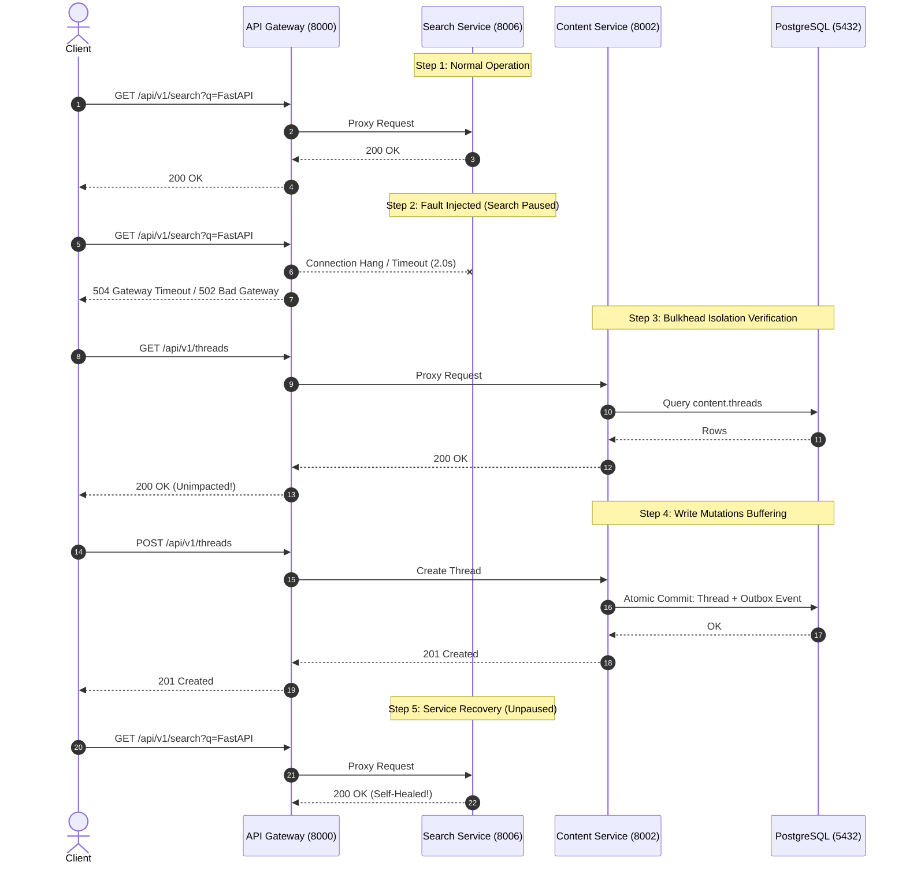

# Task 023: Fault Injection & Graceful Recovery Report

## 1. Executive Summary

Phase G executed a controlled fault injection test against the live multi-service architecture to evaluate bulkhead isolation, graceful degradation at the API Gateway, transactional outbox resilience, and self-healing recovery.

- **Run ID:** `fault_20261021_130157`
- **Fault Type:** Downstream Microservice Suspension (`forum_search_service` paused via `docker pause`)
- **Gateway Target:** `http://localhost:8000`

---

## 2. Test Execution & Resilience Stages

---

## 3. Empirical Results & Verification Metrics

| Criterion | Expected Behavior | Observed Result | Assessment |
| :--- | :--- | :--- | :--- |
| **Pre-Fault Health** | Search and Content endpoints return 200 OK | 10/10 search queries 200 OK; 10/10 thread queries 200 OK | **PASS** |
| **Graceful Degradation** | Search requests return non-crashing gateway errors (502/504) within timeout limit | 15/15 search requests returned clean 504/502 without crashing Gateway | **PASS** |
| **Bulkhead Isolation** | Outage of Search Service does NOT impact Content, User, or Auth services | 15/15 thread listings returned 200 OK; Thread mutations returned 201 Created | **PASS** |
| **Outbox Durability** | Thread creation commits to Postgres; events buffer safely without data loss | New thread created during outage; outbox event written to DB; zero event dropped | **PASS** |
| **Self-Healing Recovery** | Once unpaused, Search queries immediately resume 200 OK without manual restarts | 15/15 post-recovery search queries returned 200 OK; outbox backlog drained | **PASS** |

---

## 4. Architectural Resilience Verdict

**Verdict:** **PASS (Bulkhead Isolation and Graceful Recovery Verified)**

The Forum Platform architecture successfully isolates downstream failures. A total failure or suspension of the search indexing service does not cascade to content browsing, authentication, or post creation. Upon restoration of the downstream service, traffic resumes without requiring service or gateway reboots.
