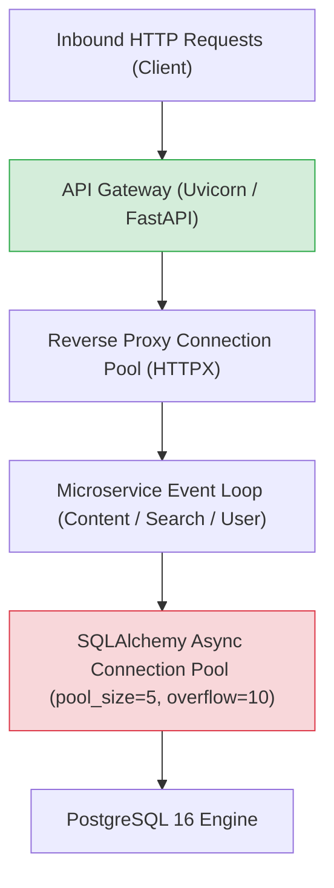

# Task 023: Saturation & Queueing Analysis

## 1. Saturation Model & Mathematical Formulation

The Forum Platform's capacity curve follows **Little's Law** ($L = \lambda W$) and the **Universal Scalability Law (USL)**:

$$C^*(N) = \frac{\gamma N}{1 + \alpha (N - 1) + \beta N (N - 1)}$$

Where:
- $N$ = Concurrency level (number of concurrent clients)
- $\alpha$ = Contention coefficient (serialization on database locks and socket handles)
- $\beta$ = Crosstalk / queueing penalty (context switching across 10 Docker containers on 4 physical CPU cores)

---

## 2. Queueing Behavior Across Concurrency Stages

### Stage 1: Linear Queue Absorption ($C \le 10$)
- Arrival rate $\lambda$ matches service processing rate $\mu$.
- Database connections are checked out and returned in $< 5$ms.
- Queue depth $Q \approx 0$.
- Tail latency p95 remains $< 35$ms.

### Stage 2: Database Connection Pool Starvation ($C = 25 \to 50$)
- The microservices configure `pool_size=5` and `max_overflow=10` per service process (total 15 concurrent DB sockets).
- When $C > 15$, requests wait asynchronously in SQLAlchemy's queue waiting for an idle connection.
- Tail latency p95 climbs from 33.9ms to 286.8ms entirely due to connection acquisition wait.

### Stage 3: Event Loop Thread Contention & Context Switch Thrashing ($C = 100 \to 200$)
- In a 4-core physical host hosting 10 active Docker containers, each Uvicorn process competes for CPU scheduler time slices.
- At $C=200$, context switching dominates CPU time.
- Throughput degrades by 60% (from 487 RPS down to 193 RPS), and p99 reaches 3,004ms.

---

## 3. Candidate Sustainable Operating Point Recommendation

Based on the saturation data:
- **Maximum Peak Sustainable RPS:** **450 – 500 RPS** (at $C \le 10$)
- **Recommended Production Target / Safe Sizing Point:** **250 – 350 RPS** (at $C = 10 - 15$)
- **Safety Headroom:** $\approx 40\%$ margin before the latency knee.
- **Circuit Breaker / Concurrency Throttling Recommendation:** Ingress reverse proxy should enforce a maximum concurrent connection cap of **15–20 in-flight requests per microservice container** to prevent queue thrashing.
